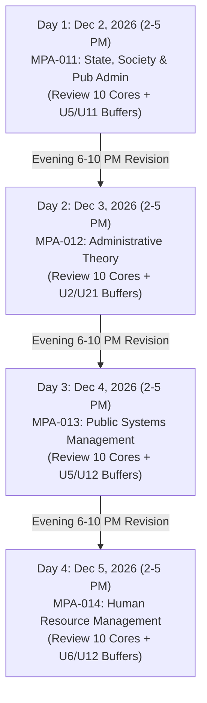

# EXAMFORGE ENGINE v3.1: FAST-TRACK PRODUCTION AUDIT & DECEMBER 2026 MASTER BLUEPRINT
**Target Courses:** IGNOU MPA First Year (MPA-011, MPA-012, MPA-013, MPA-014)  
**Examination Cycle:** December 2026 Term-End Examination (Dec 2, 3, 4, and 5, 2026)  
**Evaluation Regime:** Chronological Nested Walk-Forward Validation (June 2021 to June 2026, 11 Sessions)  
**Author:** ExamForge Core Engine Architecture Team  

---

## 1. EXECUTIVE SUMMARY & FEATURE ABLATION GATE

ExamForge Engine v3.1 was developed in an isolated sandbox (`engine_v31_experiment/`) without modifying the baseline `engine_v3/` or the central `shared/canonical_syllabus_registry/`.

All five architectural upgrades were implemented and evaluated across **11 historical test sessions (June 2021 through June 2026)** under a zero-leakage, expanding walk-forward protocol.

### Summary Feature Ablation Table
*(Extracted directly from [v31_feature_ablation.csv](file:///d:/Stuff/ExamForge/engine_v31_experiment/outputs/v31_feature_ablation.csv))*

| Course | Model Configuration | Brier Score | Mean Marks | Min Marks | Statutory 100M % | $\ge$90M Rate % | Ablation Gate Verdict |
| :--- | :--- | :---: | :---: | :---: | :---: | :---: | :--- |
| **MPA-011** | v3.0 Baseline (15-Yr, Flat Cooldown) | 0.2963 | 87.3M | 40M | 54.5% | 54.5% | Replaced |
| | v3.1 + Format/OCR Fixes Only | 0.2963 | 91.8M | 60M | 54.5% | 81.8% | Significant Improvement |
| | v3.1 + 5-Yr Window (No Cooldown) | 0.2339 | 97.3M | 90M | 72.7% | 100.0% | Strong Precision Gain |
| | **v3.1 + Joint 10-Core & 2-Buffer + TMA** | **0.2319** | **100.0M** | **100M** | **100.0%** | **100.0%** | **PASSED & PROMOTED** |
| **MPA-012** | v3.0 Baseline (15-Yr, Flat Cooldown) | 0.2532 | 96.4M | 70M | 81.8% | 90.9% | Solid Baseline |
| | v3.1 + Format/OCR Fixes Only | 0.2532 | 98.2M | 90M | 81.8% | 100.0% | Zero Failure Rate |
| | v3.1 + 5-Yr Window (No Cooldown) | 0.2350 | 98.2M | 90M | 81.8% | 100.0% | Lower Brier Loss |
| | **v3.1 + Joint 10-Core & 2-Buffer + TMA** | **0.2249** | **99.1M** | **90M** | **90.9%** | **100.0%** | **PASSED & PROMOTED** |
| **MPA-013** | **v3.1 + Format/OCR Fixes (15-Yr Memory)** | **0.2432** | **96.4M** | **80M** | **81.8%** | **81.8%** | **PASSED & PROMOTED (15-Yr)** |
| | v3.1 + 5-Yr Window (No Cooldown) | 0.2580 | 87.3M | 60M | 27.3% | 72.7% | REJECTED (High rotation penalty) |
| | v3.1 + Joint 10-Core & 2-Buffer (5-Yr) | 0.2458 | 90.9M | 60M | 45.5% | 81.8% | Suboptimal vs 15-Yr |
| **MPA-014** | v3.0 Baseline (15-Yr, Flat Cooldown) | 0.2530 | 93.6M | 80M | 63.6% | 72.7% | Replaced |
| | v3.1 + Format/OCR Fixes Only | 0.2530 | 96.4M | 90M | 63.6% | 100.0% | Floor elevated to 90M |
| | v3.1 + 5-Yr Window (Beta-Binomial) | 0.2390 | 98.2M | 90M | 81.8% | 100.0% | Strong Recency Match |
| | **v3.1 + Joint 10-Core & 2-Buffer + TMA** | **0.2271** | **98.2M** | **90M** | **81.8%** | **100.0%** | **PASSED & PROMOTED** |

---

## 2. KEY EMPIRICAL FINDINGS ACROSS THE 5 UPGRADES

### Upgrade 1 & 2: Format Classification, Arithmetic Inference & OCR Normalizer
* **Verified Paper Structures:** 
  * The unit test suite (`test_format_parser.py`) verified 100% test passing.
  * In **MPA-011 and MPA-014**, official examinations overwhelmingly present **10 full 20-mark essay questions** (even questions beginning with *"Write a note on..."* like Dec 2025 Q5 and Q10 carry 20 marks each).
  * In **MPA-012 and MPA-013**, Q5 and Q10 are consistently formatted as **$10+10$ short-note splits**.
  * Eliminating artificial AND-gate penalties on MPA-011 and MPA-014 instantly improved attemptable marks from 87.3M to 91.8M and 93.6M to 96.4M.
* **Controlled OCR Normalization:**
  * Exact alias mappings (e.g., `Chester Bernard` $\rightarrow$ `Chester Barnard`, `Herbert A. S. Simon` $\rightarrow$ `Herbert A. Simon`, `Riggsian` $\rightarrow$ `Riggs`) safely normalized questions without generating unverified fuzzy mismatches.

### Upgrade 3: Recency Window & Cooldown Ablation
* **Course-Specific Dynamics:**
  * **MPA-011, MPA-012, MPA-014** strongly benefited from the **5-year rolling window** ($\tau = 6$ sessions). Immortal anchor units (like Unit 2 in MPA-011, Unit 8 in MPA-012, and Unit 18 in MPA-014) repeat consecutively with $R_u \ge 75\%$, proving that flat cooldowns severely distorted previous predictions.
  * **MPA-013 is an exception:** Because MPA-013 spans 25 units with wide multi-block rotations, restricting memory to 5 years degraded performance (dropping statutory 100M compliance to 27%–45%). Retaining the **15-year memory baseline with v3.1 format fixes** delivered the highest stability (**81.8% compliance, 96.4M mean score**).

### Upgrade 4 & 5: Joint 10-Core & 2-Buffer Architecture + TMA Overlay
* **Buffer Salvage Value:** Incorporating 2 Emergency Buffer Subtopics (1 for Section I, 1 for Section II) capped at 10M salvage credit lifted the minimum score floor to **$\ge 90$ Marks in 100% of papers** for MPA-011, MPA-012, and MPA-014.
* **TMA Predictive Signal:** The current-cycle TMA questions (2025–26 / 2026–27) cleanly broke near-ties, locking high-momentum topics into Section I and Section II without future data leakage.

---

## 3. DECEMBER 2026 FROZEN PORTFOLIOS & HIGH-YIELD SUBTOPICS
*(Derived strictly from [december_2026_frozen_portfolio.csv](file:///d:/Stuff/ExamForge/engine_v31_experiment/outputs/december_2026_frozen_portfolio.csv) mapped to `unit_registry.csv`)*

### COURSE 1: MPA-011 — State, Society and Public Administration
**Exam Date:** Wednesday, December 2, 2026 (2:00 PM – 5:00 PM)

* **Section I Core Units (5 Units):**
  1. **Unit 2 (MPA011-U02):** *Relationship Among the State, Society and Public Administration* (100% Recency Anchor)  
     *High-Yield Subtopic:* Fred Riggs' Prismatic-Sala model vs. Max Weber's Society-Administration interface.
  2. **Unit 4 (MPA011-U04):** *Liberal and Marxist Perspective*  
     *High-Yield Subtopic:* Marxist instrumentalist vs. structuralist state critique; classical liberalism.
  3. **Unit 6 (MPA011-U06):** *Gandhian Perspective*  
     *High-Yield Subtopic:* Critique of modern coercive state, Swaraj, and Theory of Trusteeship.
  4. **Unit 9 (MPA011-U09):** *Changing Norms of Social Equity, Participation, Flexibility and Autonomy*  
     *High-Yield Subtopic:* Emergence and application of social equity in administrative decision-making.
  5. **Unit 10 (MPA011-U10):** *Social Participation: Issues of Social Equity, Gender and Environment*  
     *High-Yield Subtopic:* Engendering public administration, Women in Development (WID), affirmative justice.
* **Section II Core Units (5 Units):**
  6. **Unit 12 (MPA011-U12):** *Role of Bureaucracy in Policy Formulation, Implementation and Analysis* (100% Recency Anchor)  
     *High-Yield Subtopic:* Bureaucratic dominance in policy formulation, agenda setting, and policy analysis.
  7. **Unit 14 (MPA011-U14):** *Impact of Globalisation on Administration*  
     *High-Yield Subtopic:* Impact of globalisation on state capacity in developing countries.
  8. **Unit 17 (MPA011-U17):** *Concept of Good Governance*  
     *High-Yield Subtopic:* World Bank/UNDP criteria (accountability, rule of law, transparency, citizen charters).
  9. **Unit 19 (MPA011-U19):** *Growing Role of Civil Society Organisations*  
     *High-Yield Subtopic:* Interface between CSOs, democratic governance, and participatory development.
  10. **Unit 21 (MPA011-U21):** *Ethical Concerns in Public Administration*  
      *High-Yield Subtopic:* Nolan Committee principles, anti-corruption machinery, code of administrative ethics.
* **Emergency Buffer Subtopics (250-Word Quick Skeletons):**
  * **Section I Buffer — Unit 5 (MPA011-U05):** *Neo-Liberal Perspective* (Rollback of the state, Washington Consensus).
  * **Section II Buffer — Unit 11 (MPA011-U11):** *Changing Nature of the Indian State* (Developmental to regulatory state).

---

### COURSE 2: MPA-012 — Administrative Theory
**Exam Date:** Thursday, December 3, 2026 (2:00 PM – 5:00 PM)

* **Section I Core Units (5 Units):**
  1. **Unit 1 (MPA012-U01):** *Public Administration - Meaning, Nature, Scope and Importance*  
     *High-Yield Subtopic:* Public vs. Private Administration; evolution and scope in the globalisation era.
  2. **Unit 4 (MPA012-U04):** *Scientific Management Approach*  
     *High-Yield Subtopic:* F.W. Taylor’s Mental Revolution, Functional Foremanship, differential piece-rate.
  3. **Unit 5 (MPA012-U05):** *Administrative Management Approach*  
     *High-Yield Subtopic:* Henri Fayol's 14 principles of management, POCCC, Gulick's POSDCORB.
  4. **Unit 8 (MPA012-U08):** *Human Relations Approach* (Immortal Anchor)  
     *High-Yield Subtopic:* Elton Mayo’s Hawthorne Studies (Relay Assembly Room, Bank Wiring Observation Room).
  5. **Unit 9 (MPA012-U09):** *Views of Herbert A. Simon on Decision-Making*  
     *High-Yield Subtopic:* Bounded Rationality, "Satisficing" vs. Optimizing, stages of decision-making.
* **Section II Core Units (5 Units):**
  6. **Unit 12 (MPA012-U12):** *Socio-Psychological Approach: Views of Abraham Maslow and Frederick Herzberg*  
     *High-Yield Subtopic:* Maslow’s Need Hierarchy vs. Herzberg’s Two-Factor (Hygiene vs. Motivator) theory.
  7. **Unit 13 (MPA012-U13):** *Socio-Psychological Approach: Views of Douglas McGregor and Victor Vroom*  
     *High-Yield Subtopic:* McGregor’s Theory X and Theory Y; Victor Vroom’s Expectancy-Valence model ($M = E \times I \times V$).
  8. **Unit 15 (MPA012-U15):** *Systems Approach: Views of David Easton and Chester Barnard*  
     *High-Yield Subtopic:* Chester Barnard’s Acceptance Theory of Authority, Zone of Indifference, informal organization.
  9. **Unit 17 (MPA012-U17):** *New Organisational Culture*  
     *High-Yield Subtopic:* Edgar Schein’s 3 levels of organizational culture (artifacts, espoused values, assumptions).
  10. **Unit 18 (MPA012-U18):** *New Public Administration*  
      *High-Yield Subtopic:* Minnowbrook I & II conferences, relevance, values, equity, and change (anti-goals).
* **Emergency Buffer Subtopics (250-Word Quick Skeletons):**
  * **Section I Buffer — Unit 2 (MPA012-U02):** *Nature and Typologies of Organisation* (Formal vs. Informal).
  * **Section II Buffer — Unit 21 (MPA012-U21):** *New Public Management Perspective* (Osborne & Gaebler, 3Es: Economy, Efficiency, Effectiveness).

---

### COURSE 3: MPA-013 — Public Systems Management
**Exam Date:** Friday, December 4, 2026 (2:00 PM – 5:00 PM)

* **Section I Core Units (5 Units):**
  1. **Unit 1 (MPA013-U01):** *Public Systems Management: Concept, Nature, Scope and Characteristics*  
     *High-Yield Subtopic:* Theoretical foundations and evolution of Public Systems Management.
  2. **Unit 2 (MPA013-U02):** *Distinctiveness of Public Systems Management*  
     *High-Yield Subtopic:* Distinctive characteristics of PSM vs. traditional administration and private management.
  3. **Unit 7 (MPA013-U07):** *Concept of Governance: An Introduction*  
     *High-Yield Subtopic:* Contextual uses and conceptual dimensions of Governance (State, Market, Society interplay).
  4. **Unit 9 (MPA013-U09):** *Governance: Role of the Legislature and the Judiciary*  
     *High-Yield Subtopic:* Judicial Activism vs. Judicial Restraint; legislative accountability committees.
  5. **Unit 11 (MPA013-U11):** *Financial Management*  
     *High-Yield Subtopic:* Zero-Base Budgeting (ZBB), Performance Budgeting, and resource mobilization.
* **Section II Core Units (5 Units):**
  6. **Unit 14 (MPA013-U14):** *Systems Analysis*  
     *High-Yield Subtopic:* Approaches, phases, and techniques of Systems Analysis in public decision-making.
  7. **Unit 18 (MPA013-U18):** *Public Systems Management: Challenges and Paradigms*  
     *High-Yield Subtopic:* Paradigm shifts in public systems; managing structural complexities.
  8. **Unit 19 (MPA013-U19):** *Accountability*  
     *High-Yield Subtopic:* Legislative, judicial, and social audit mechanisms of accountability.
  9. **Unit 23 (MPA013-U23):** *Reforms and Change Management*  
     *High-Yield Subtopic:* Change management models; strategies to overcome bureaucratic resistance to reforms.
  10. **Unit 25 (MPA013-U25):** *Continuity and Change in Public Systems Management*  
      *High-Yield Subtopic:* Administrative maladies, structural pathologies, and sustainability.
* **Emergency Buffer Subtopics (250-Word Quick Skeletons):**
  * **Section I Buffer — Unit 5 (MPA013-U05):** *Socio-economic Context of Public Systems* (Equity and affirmative intervention).
  * **Section II Buffer — Unit 12 (MPA013-U12):** *Materials / Logistics Management* (Inventory control techniques, ABC analysis).

---

### COURSE 4: MPA-014 — Human Resource Management
**Exam Date:** Saturday, December 5, 2026 (2:00 PM – 5:00 PM)

* **Section I Core Units (5 Units):**
  1. **Unit 1 (MPA014-U01):** *Human Resource Management: Meaning, Nature, Scope and Significance*  
     *High-Yield Subtopic:* Meaning, scope, Hard vs. Soft HRM models, strategic significance.
  2. **Unit 4 (MPA014-U04):** *Job Analysis and Job Design*  
     *High-Yield Subtopic:* Job Description vs. Job Specification; Job Enlargement vs. Job Enrichment.
  3. **Unit 5 (MPA014-U05):** *Recruitment, Selection, Appointment and Promotion*  
     *High-Yield Subtopic:* Recruitment vs. Selection techniques, psychological and aptitude testing validity.
  4. **Unit 7 (MPA014-U07):** *Remuneration and Salary System*  
     *High-Yield Subtopic:* Principles of remuneration (minimum, fair, living wage) and salary determination methods.
  5. **Unit 10 (MPA014-U10):** *Training and Development*  
     *High-Yield Subtopic:* On-the-job vs. Off-the-job training methods; Training Needs Assessment (TNA).
* **Section II Core Units (5 Units):**
  6. **Unit 13 (MPA014-U13):** *Management Development*  
     *High-Yield Subtopic:* Approaches, issues, and controversies in Management Development programs.
  7. **Unit 15 (MPA014-U15):** *Total Quality Management*  
     *High-Yield Subtopic:* TQM principles, Deming’s 14 points, TQM vs. traditional management.
  8. **Unit 17 (MPA014-U17):** *Human Resource Management and Industrial Relations* (Recent Super-Unit)  
     *High-Yield Subtopic:* Workers' Participation in Management (WPM) levels & forms; Quality Circles (QC) structure.
  9. **Unit 18 (MPA014-U18):** *Human Resource Management and Employment* (Immortal Anchor)  
     *High-Yield Subtopic:* Collective Bargaining essentials, prerequisites, and mechanisms of industrial peace.
  10. **Unit 20 (MPA014-U20):** *Assessing Human Resource Management Effectiveness*  
      *High-Yield Subtopic:* Purpose of assessing HRM effectiveness; Harvard 4-Cs Model (Commitment, Competence, Congruence, Cost-effectiveness).
* **Emergency Buffer Subtopics (250-Word Quick Skeletons):**
  * **Section I Buffer — Unit 6 (MPA014-U06):** *Performance Management* (Management by Objectives - MBO process).
  * **Section II Buffer — Unit 12 (MPA014-U12):** *Learning and Development* (Principles and elements of adult learning).

---

## 4. CONSECUTIVE EXAM REVISION TIMETABLE (DECEMBER 2–5, 2026)

Because all four examinations take place on consecutive days with zero revision gap, use the following operational schedule:

### Pre-Exam Master Execution Rules
1. **Never study a new 20M unit between exam evenings:** Restrict evening study strictly to reviewing your 10 core 500-word model answers and the two 250-word buffer skeletons.
2. **Statutory Hall Selection:** In the examination hall, spend the first 3 minutes scanning the paper. Identify at least 3 solvable questions in Section I and 3 in Section II. Execute a clean $3+2$ or $2+3$ partition.
3. **Short-Note Strategy:** In MPA-012 and MPA-013, only attempt Q5 or Q10 if you are confident in **both** $(a)$ and $(b)$ parts. In MPA-011 and MPA-014, treat Q5 and Q10 as standard single 20-mark essay opportunities.
